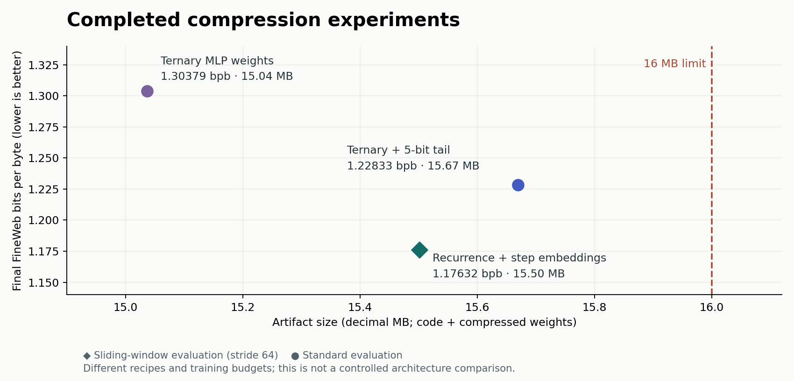

# Parameter Golf: Small Language Model Compression Experiments

**Recurrence, ternary quantization, and selective precision under a 16 MB model budget.**

This repository documents my experiments for OpenAI's Parameter Golf competition. I explored how shared transformer blocks and aggressive weight compression can improve language modeling within a fixed artifact size, using an RTX 5060 for local experiments and an RTX 5090 for a promoted run.

**Best documented result: 1.17631839 bits per byte with a 15.50 MB artifact on one RTX 5060.** The model uses 8 unique transformer blocks for 10 effective layers, with learned embeddings to distinguish recurrent passes.

This is Shasank's competition fork of [openai/parameter-golf](https://github.com/openai/parameter-golf), now organized as a completed experiment portfolio. The featured runs are **unlimited-compute, non-record experiments**; they do not establish compliance with the 10-minute, 8×H100 leaderboard track.

[Results and lessons](docs/RESULTS.md) · [Reproduce the experiments](docs/REPRODUCING.md) · [Original competition documentation](COMPETITION.md)

## My contributions

- **Depth recurrence:** adapted the training model to reuse a middle pair of transformer blocks, with learned step embeddings so repeated passes can specialize without duplicating the core weights.
- **Ternary MLP experiments:** explored quantization-aware training and export for MLP weights, then scaled the branch to 15 layers and 20,000 training steps.
- **Selective precision:** kept most MLP weights ternary while protecting the final MLP block with 5-bit precision; the completed hybrid run reached 1.22833292 bits per byte.
- **Export and evaluation:** tuned bigram precision and pruning to fit the byte limit, and checked quality after exporting and reloading the compressed model.
- **Experiment engineering:** developed checkpoint continuation, quantized-proxy validation, and log comparison workflows. The included [comparison tool](tools/compare_runs.py) lets readers inspect the archived runs without a GPU.

These changes build on the competition trainer and community methods, including mixed-bit compression, BigramHash, SmearGate, Muon optimization, and weight averaging. The original challenge, baseline, dataset pipeline, and community leaderboard entries belong to their respective authors.

## Completed results

Scores are FineWeb validation **bits per byte (lower is better)** after compressed-model export and reload. Sizes include the recorded code and compressed weights; MB means 1,000,000 bytes.

| Experiment | Final bits/byte ↓ | Artifact | GPU | Steps | Final evaluation | Evidence |
| --- | ---: | ---: | --- | ---: | --- | --- |
| **Shared-block recurrence + step embeddings** | **1.17631839** | **15.50 MB** | RTX 5060 | 20,000 | Sliding window, stride 64 | [Code, log, metadata](records/track_non_record_16mb/2026-04-04_Full80_Recurrence_StepEmbed_Seq1536_20k/) |
| 15-layer ternary + 5-bit tail MLP | 1.22833292 | 15.67 MB | RTX 5090 | 20,000 | Standard | [Code, log, metadata](records/track_non_record_16mb/2026-04-03_15L_HybridTail_Seq1536_20k_1x5090/) |
| 15-layer ternary MLP weights | 1.30378846 | 15.04 MB | RTX 5060 | 20,000 | Standard | [Code, log, metadata](records/track_non_record_16mb/2026-03-27_15L_Ternary_MLPOnly_20k/) |



These are results from different training recipes, budgets, hardware, and evaluation modes, rather than a controlled architecture comparison. The recurrence run's recorded training time is about 11.03 hours, including its initial 10k stage; final evaluation took a further 3.86 hours. See [measurement details](docs/RESULTS.md) for exact sizes, timings, and limitations. The folders preserve prepared non-record submission packages; no upstream acceptance or competition placement is claimed here.

## What I learned

- **The exported model is the result.** Full-precision validation can misrepresent ternary model quality. A quantized proxy and the final export/reload evaluation were more useful signals.
- **Precision placement matters.** Protecting the tail MLP was a useful alternative to simply widening every ternary MLP. The experiment ledger also contains configurations that improved quality but exceeded the byte cap.
- **More training does not always help.** The pure ternary branch's 25k extension scored worse than its 20k checkpoint.
- **Resume behavior needs explicit checks.** A checkpoint saved after learning-rate warmdown can resume at zero learning rate. The successful recurrence continuation used an explicit extension scale.

The [results discussion](docs/RESULTS.md) includes negative experiments and distinguishes observations from untested ideas.

## Inspect or rerun

No GPU is needed to read the logs or compare the completed results:

```bash
git clone https://github.com/shasank0001/parameter-golf.git
cd parameter-golf
python3 tools/compare_runs.py \
  records/track_non_record_16mb/2026-03-27_15L_Ternary_MLPOnly_20k/train.log \
  records/track_non_record_16mb/2026-04-03_15L_HybridTail_Seq1536_20k_1x5090/train.log
```

For CUDA setup, data download, and the two-stage recurrence training recipe, use the [reproduction guide](docs/REPRODUCING.md). Historical checkpoints and compressed weights are not bundled; the published evidence consists of source snapshots, logs, and metadata.

## Repository map

| Path | Purpose |
| --- | --- |
| [`docs/RESULTS.md`](docs/RESULTS.md) | Results, measurement conventions, and experiment lessons |
| [`docs/REPRODUCING.md`](docs/REPRODUCING.md) | Setup and recurrence training recipe |
| [`records/track_non_record_16mb/`](records/track_non_record_16mb/) | Completed personal experiments alongside inherited community records; use the links above for my three runs |
| [`tools/compare_runs.py`](tools/compare_runs.py) | Compare logged training losses and final metrics |
| [`train_gpt.py`](train_gpt.py), [`train_gpt_mlx.py`](train_gpt_mlx.py) | Inherited competition starting points; featured experiments use the snapshots in their record folders |
| [`data/`](data/) | Competition data download and tokenizer workflows |
| [`COMPETITION.md`](COMPETITION.md) | Archived competition README, including the community leaderboard |

## Credits and license

Project experiments by [Shasank](https://github.com/shasank0001). Forked from [OpenAI Parameter Golf](https://github.com/openai/parameter-golf), which adapts [modded-nanogpt](https://github.com/KellerJordan/modded-nanogpt). Community record folders retain their original attribution. See the [MIT license](LICENSE) and [third-party notices](THIRD_PARTY_NOTICES.md).
