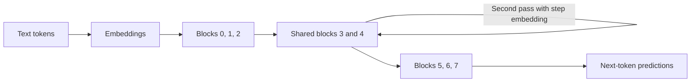
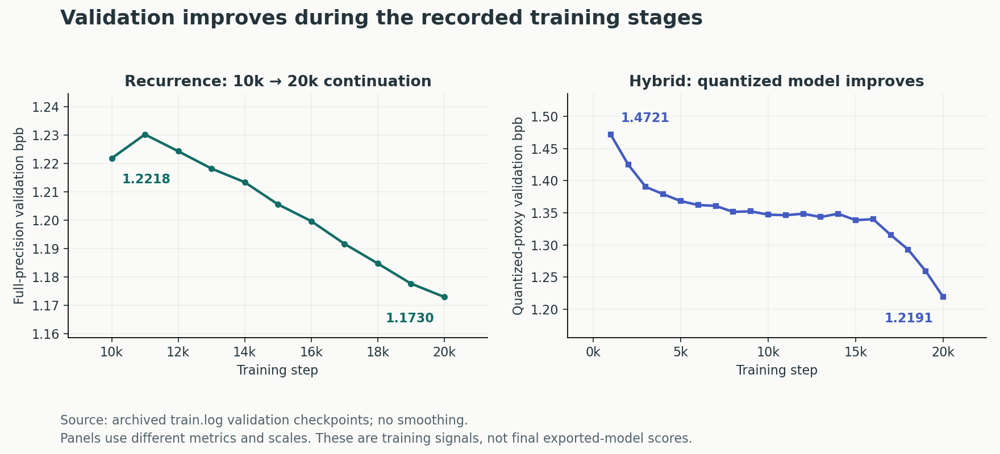
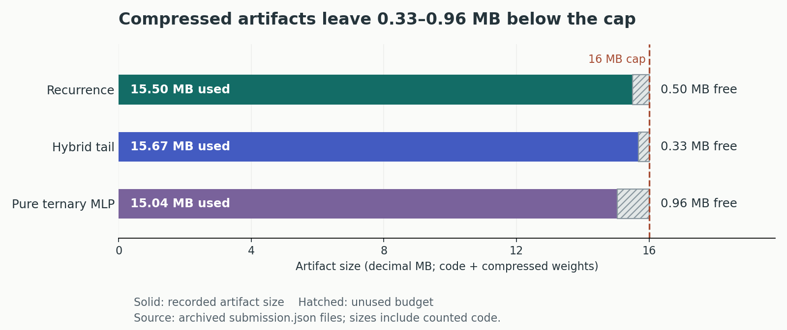

# Parameter Golf: Small Language Models in 16 MB

**Training language models that predict text well and fit into 16 MB.**

This is my experiment portfolio from OpenAI's Parameter Golf competition. The task was to train a model that predicts unseen text well while keeping its saved weights and code below **16 MB**. I worked on two ways to use that small budget: reusing model layers and storing weights with fewer bits.

My best documented model reached **1.1763 bits per byte at 15.50 MB**, trained on **one NVIDIA RTX 5060**. Bits per byte measures how efficiently the model predicts the validation text; **lower is better**. I used Python, PyTorch, and CUDA for training, and also trained one model on an RTX 5090.

I adapted the competition code, ran and compared experiments, and documented the results. These are completed **unlimited-compute, non-record experiments**, rather than results from the 10-minute leaderboard track. The repository remains a fork of [OpenAI's original project](https://github.com/openai/parameter-golf).

[Results and evidence](#results-and-evidence) · [How the models work](#how-the-models-work) · [Training graphs](#what-the-training-logs-show) · [Run it yourself](#inspect-or-rerun)

## What I contributed

| Area | My work | Why it matters |
| --- | --- | --- |
| Layer sharing | Reused a pair of transformer blocks and added learned embeddings to distinguish repeated passes. | Adds computation without storing a separate set of core weights for every pass. |
| Ternary MLP weights | Developed and evaluated a 15-layer branch that constrains feed-forward weights to three quantized levels. | Makes room for more model capacity within the file-size limit. |
| Selective precision | Kept most MLP weights ternary while protecting the final MLP with 5-bit precision. | Explores where extra precision is more useful than uniform compression. |
| Export and evaluation | Tuned bigram precision and pruning, then measured the exported and reloaded model. | Checks whether a training improvement survives compression and fits the budget. |
| Experiment engineering | Added checkpoint continuation, quantized-proxy validation, and log comparison workflows. | Makes long runs easier to resume and their outcomes easier to inspect. |

The foundation comes from the competition trainer and community methods, including mixed-bit compression, BigramHash, SmearGate, Muon optimization, and weight averaging. My contributions are the adaptations and experiments described here; the original challenge and inherited community records retain their attribution.

## Results and evidence

All three featured models completed **20,000 training steps**. Their scores below were measured after saving, compressing, and reloading the model. Artifact sizes count **code plus compressed weights**, using decimal MB.

| Experiment | Final bits/byte ↓ | Artifact | GPU | Training time | Final evaluation | Evidence |
| --- | ---: | ---: | --- | ---: | --- | --- |
| **Shared-block recurrence + step embeddings** | **1.17631839** | **15.50 MB** | RTX 5060 | 11.03 h | Sliding window, stride 64 | [Code, log, metadata](records/track_non_record_16mb/2026-04-04_Full80_Recurrence_StepEmbed_Seq1536_20k/) |
| 15-layer ternary + 5-bit tail MLP | 1.22833292 | 15.67 MB | RTX 5090 | 3.25 h | Standard | [Code, log, metadata](records/track_non_record_16mb/2026-04-03_15L_HybridTail_Seq1536_20k_1x5090/) |
| 15-layer ternary MLP weights | 1.30378846 | 15.04 MB | RTX 5060 | 6.52 h | Standard | [Code, log, metadata](records/track_non_record_16mb/2026-03-27_15L_Ternary_MLPOnly_20k/) |


**How to read the comparison:** these runs differ in architecture, training budget, hardware, and evaluation. The recurrence result uses overlapping evaluation windows to give predictions more context. The table compares completed recipes; it does not isolate the gain from one architectural change. Training times exclude final evaluation, which added about **3.86 hours** for the recurrence model. See [exact measurements and limitations](docs/RESULTS.md).

## How the models work

### 1. Reuse layers instead of storing every layer separately

A transformer normally stores different weights for each layer. The recurrence model runs the same middle pair of blocks twice. A small learned **step embedding** tells the shared blocks which pass they are performing.



This is a simplified view of the repeated computation; residual and skip connections are omitted. The actual block order is:

```text
0 → 1 → 2 → 3 → 4 → 3 → 4 → 5 → 6 → 7
```

That gives **10 effective layers from 8 unique blocks**, with about **25.9 million parameters**. The final recipe uses model width 576, a 1,536-token training context, step embeddings, and mixed-bit export. It continued a saved 10k checkpoint to 20k steps.

The earlier mixed-lowbit control scored **1.21832265 bpb** with the same stride-64 final evaluation. The recurrence recipe reached **1.17631839 bpb**, an observed reduction of **0.0420 bpb (3.45%)**. Architecture, schedule, and export settings changed together, so this is a recipe-level improvement. The [results discussion](docs/RESULTS.md#why-recurrence-was-the-main-result) links the control's recorded finalization output.

### 2. Compress MLP weights, then protect a sensitive block

The **MLP** is the feed-forward part of each transformer block. In the ternary branch, its quantized weights use three levels, with per-row scaling, instead of storing every weight at ordinary floating-point precision. Attention and other tensors keep their own precision.

The hybrid branch makes a targeted exception: it stores the final MLP block at **5 bits** while keeping the other MLPs on the ternary path. This trades a small amount of file space for a more flexible final block.

| Setting | Recurrence | Pure ternary MLP | Hybrid tail |
| --- | --- | --- | --- |
| Effective / unique layers | 10 / 8 | 15 / 15 | 15 / 15 |
| Model width | 576 | 512 | 512 |
| Training context | 1,536 tokens | 1,024 tokens | 1,536 tokens |
| Training batch | 122,880 tokens | 65,536 tokens | 122,880 tokens |
| MLP compression | Mixed low-bit | Ternary weights | Ternary, except 5-bit final MLP |
| Bigram export precision | 4 bits | 5 bits | 5 bits |

The hybrid result also changed context length and training batch, so its full improvement cannot be attributed to tail precision alone. The [pure ternary](records/track_non_record_16mb/2026-03-27_15L_Ternary_MLPOnly_20k/README.md) and [hybrid](records/track_non_record_16mb/2026-04-03_15L_HybridTail_Seq1536_20k_1x5090/README.md) packages contain the exact configurations.

## What the training logs show

The graph below uses validation checkpoints from the archived logs, without smoothing or invented measurements. The recurrence log begins at its **10k resume point**. For the hybrid run, the useful training signal is the **quantized proxy**: a temporary quantized copy evaluated during training.



| Logged training signal | First point shown | Last point shown |
| --- | ---: | ---: |
| Recurrence, full-precision validation | 1.2218 at step 10,000 | 1.1730 at step 20,000 |
| Hybrid, quantized-proxy validation | 1.4721 at step 1,000 | 1.2191 at step 20,000 |

These curves describe progress **within each run**. They are not the final exported-model scores. Weight averaging, pruning, serialization, and the final evaluation protocol happen later. In particular, ordinary full-precision validation was a misleading guide for the ternary branch; measuring a quantized proxy made its progress easier to judge.

### Fitting the artifact budget

The final size check is strict: **16,000,000 bytes**, including code. The recurrence recipe used 4-bit bigram export and 3.3% one-shot magnitude pruning to stay under that cap. The bigram component adds features from adjacent token pairs; its export precision is another way to trade bytes against quality.



| Model | Recorded total | Space below the cap |
| --- | ---: | ---: |
| Recurrence | 15,501,266 bytes | 498,734 bytes |
| Hybrid tail | 15,669,833 bytes | 330,167 bytes |
| Pure ternary MLP | 15,037,372 bytes | 962,628 bytes |

The [plotting script](docs/assets/plot_results.py) regenerates all three figures from the published metadata and logs. Source changes or a different compression library can alter a future artifact's size.

## Experiment process and lessons

My workflow moved from short checks to longer runs: validate the code and export path, compare promising candidates, continue the stronger ones, then check the final compressed artifact. The local experiment ledger records both successful and discarded directions; [selected observations](docs/RESULTS.md#negative-results-and-engineering-lessons) are summarized in the results discussion.

- **Measure what will actually be saved.** A good full-precision validation score is not enough if compression changes the model's behavior.
- **Spend precision selectively.** Wider ternary MLPs improved a short run but exceeded 16 MB. Targeted precision and export adjustments provided other ways to use the budget.
- **Check longer training against a stopping point.** The pure ternary model's 25k extension scored 1.30946 bpb, worse than its 20k checkpoint at 1.30379.
- **Treat checkpoint continuation as part of the experiment.** A checkpoint saved after learning-rate warmdown can resume at zero learning rate. The successful recurrence continuation explicitly set its extension scale to 0.2.
- **Count evaluation cost too.** Reducing the recurrence evaluation stride from 64 to 32 barely changed the score while roughly doubling evaluation time.

These are individual runs, without repeated-seed confidence intervals. Their folders preserve prepared non-record submission packages; no competition placement or upstream acceptance is claimed. This project measures text prediction/compression, rather than chat or downstream reasoning ability.

## Inspect or rerun

Read and compare the completed runs without a GPU:

```bash
git clone https://github.com/shasank0001/parameter-golf.git
cd parameter-golf
python3 tools/compare_runs.py \
  records/track_non_record_16mb/2026-03-27_15L_Ternary_MLPOnly_20k/train.log \
  records/track_non_record_16mb/2026-04-03_15L_HybridTail_Seq1536_20k_1x5090/train.log
```

The comparison tool uses Python's standard library. For CUDA setup, FineWeb data download, and the two-stage recurrence recipe, follow the [reproduction guide](docs/REPRODUCING.md). Historical model weights and checkpoints are not bundled; source snapshots, logs, and metadata are available to inspect. The guide distinguishes recipe reconstruction from exact replay.

## Repository guide

| Path | What to find |
| --- | --- |
| [`docs/RESULTS.md`](docs/RESULTS.md) | Exact measurements, comparison limits, and negative experiments |
| [`docs/REPRODUCING.md`](docs/REPRODUCING.md) | Setup and recurrence training commands |
| [`docs/assets/`](docs/assets/) | Graphs and their generation script |
| [`records/track_non_record_16mb/`](records/track_non_record_16mb/) | Completed personal and inherited community experiments; my three packages are linked in the results table |
| [`tools/compare_runs.py`](tools/compare_runs.py) | Compare logged training losses and final metrics |
| [`train_gpt.py`](train_gpt.py), [`train_gpt_mlx.py`](train_gpt_mlx.py) | Competition starting points on GitHub; use the record snapshots for the featured experiments |
| [`data/`](data/) | Dataset and tokenizer workflows |
| [`COMPETITION.md`](COMPETITION.md) | Archived original competition README and community leaderboard |

## Credits and license

Project experiments by [Shasank](https://github.com/shasank0001). Forked from [OpenAI Parameter Golf](https://github.com/openai/parameter-golf), which adapts [modded-nanogpt](https://github.com/KellerJordan/modded-nanogpt). Community records retain their original attribution. See the [MIT license](LICENSE) and [third-party notices](THIRD_PARTY_NOTICES.md).
